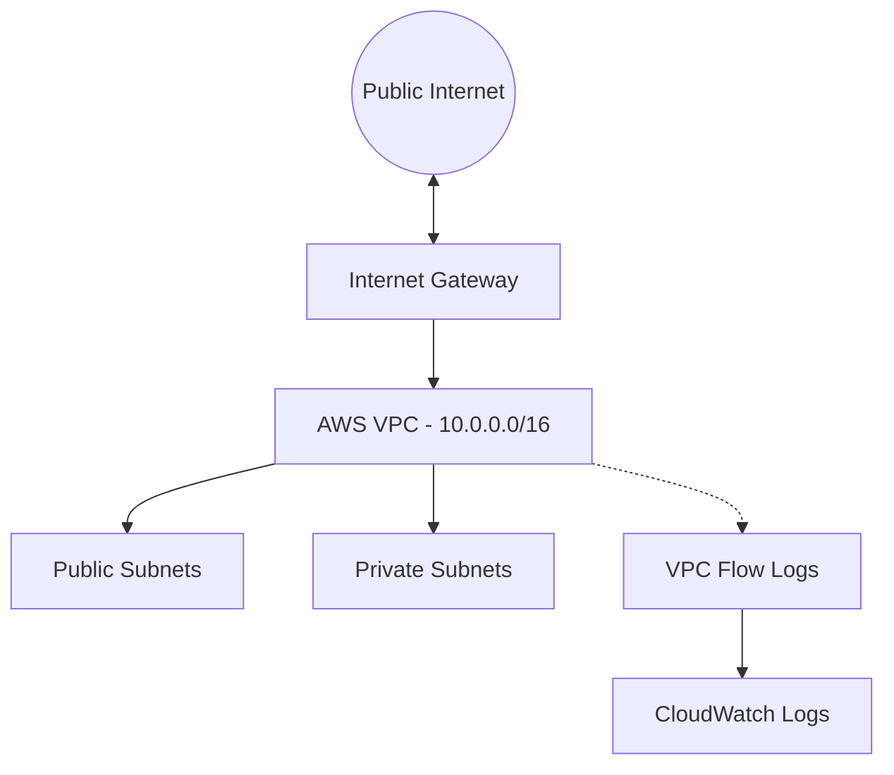

# AWS Secure VPC Sandbox & GRC Architecture Assessment

## 📌 Executive Summary
This project demonstrates professional-level cloud security architecture, Infrastructure as Code (IaC), and Governance, Risk, and Compliance (GRC) evaluation. Rather than simply deploying infrastructure via Terraform, this repository delivers a comprehensive security and risk assessment—evaluating network trust boundaries, routing controls, firewall configurations, and operational trade-offs against **NIST SP 800-53** and **ISO/IEC 27001** frameworks.

---

## 📑 Assessment Artifacts & Documentation
The core analysis and compliance documentation are organized in the `docs/` directory:

1. **[Network Control Matrix (`docs/CONTROL_MATRIX.md`)](./docs/CONTROL_MATRIX.md)**
   * Maps every Terraform resource block (`main.tf`) directly to enterprise GRC frameworks (NIST SP 800-53, ISO 27001) and security intent.
2. **[Security Findings & Risk Analysis (`docs/FINDINGS.md`)](./docs/FINDINGS.md)**
   * Evaluates routing boundaries, component security posture, structural trade-offs (e.g., private subnet egress constraints, log retention cost optimization), and strategic remediation roadmaps.

---

## 📂 Repository Structure
```text
aws-vpc-secure-sandbox-grc/
├── .github/
│   └── workflows/
│       └── security.yml          # CI/CD Checkov static analysis pipeline
├── docs/
│   ├── CONTROL_MATRIX.md         # Technical-to-GRC framework mapping
│   └── FINDINGS.md               # Risk analysis, component review, & security findings
├── .gitignore                    # Excludes local state files and binaries
├── main.tf                       # Declarative Terraform infrastructure code
└── README.md                     # Project landing page & architecture overview


## 🏗️ Network Architecture

The diagram below illustrates the intended VPC layout, subnet boundaries, internet routing, and network logging. Private subnet routing and security group rules should be verified against the Terraform implementation.


## Architecture Diagram



